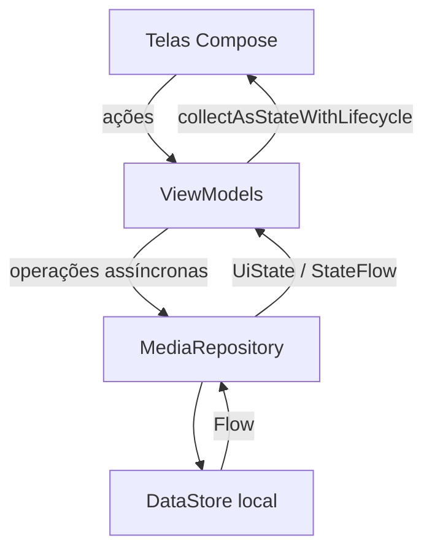

# MediaTracker — livros e filmes

Aplicativo Android para organizar uma coleção pessoal, acompanhar páginas lidas ou minutos assistidos e registrar notas e anotações. O fluxo principal funciona offline e mantém os dados depois de fechar e reabrir o aplicativo.

**Aluno:** Vinícius Vilela Paulino — RA 769867.

Projeto desenvolvido a partir da base das aulas [AC322A_MediaTracker, de betopompolo](https://github.com/betopompolo/AC322A_MediaTracker), commit `ae2f9752cf0cd1d6ca1f8a2ffbb2f8db741ae465`. As imagens, fontes e a proposta original vêm dessa base. O [enunciado original](docs/Avaliação.md) foi preservado.

## Como executar no Android Studio

1. Clone o repositório ou extraia o ZIP e abra a pasta que contém `settings.gradle.kts` em **File → Open**.
2. Use uma versão do Android Studio compatível com Android Gradle Plugin 8.13.2. Em **Settings → Build, Execution, Deployment → Build Tools → Gradle**, escolha um **JDK 17** para Gradle.
3. No **SDK Manager**, instale **Android SDK Platform 36** e **Android SDK Build-Tools 35.0.0**. A primeira sincronização requer internet para baixar as dependências.
4. Aguarde o Gradle Sync. Crie um emulador ou conecte um celular com **Android 8.0 / API 26 ou superior** e depuração USB ativada.
5. Selecione a configuração `app` e clique em **Run**. A primeira tela é **Minha coleção**.

Não é necessário modificar o código, configurar uma API, criar conta ou fornecer `.env`. O projeto já inclui o Gradle Wrapper e todas as versões estão fixadas. O Android Studio cria `local.properties` com o caminho do SDK; esse arquivo não deve ser versionado.

### Pelo terminal

Na raiz do projeto, com JDK 17 e o SDK Android instalado (configure `ANDROID_HOME` se o IDE ainda não gerou `local.properties`):

```bash
./gradlew assembleDebug testDebugUnitTest lintDebug assembleDebugAndroidTest
```

No PowerShell do Windows:

```powershell
.\gradlew.bat assembleDebug testDebugUnitTest lintDebug assembleDebugAndroidTest
```

APK: `app/build/outputs/apk/debug/app-debug.apk`.

Para executar os testes de interface, conecte um dispositivo ou inicie um emulador e rode:

```bash
./gradlew connectedDebugAndroidTest
```

A rotina em `.github/workflows/android.yml` compila o aplicativo, executa os testes locais (regras, persistência, ViewModels e interface com Robolectric) e lint, compila os testes instrumentados e disponibiliza o APK em cada push/PR. Ela não executa os testes instrumentados em um emulador.

## Como usar

- A primeira abertura inclui quatro obras simuladas. Elas são gravadas uma única vez; uma coleção esvaziada pelo usuário permanece vazia.
- Em **Minha coleção**, busque por título/autor ou filtre por livro/filme.
- Toque em **Adicionar**, informe título e total de páginas/minutos. Autor/direção e ano são opcionais. Campos inválidos recebem mensagens junto ao formulário.
- Após salvar, os detalhes da nova obra são abertos. Atualize o progresso, a nota opcional de 1 a 5 e as anotações. Toque em **Salvar acompanhamento** para persistir as alterações.
- É possível concluir a obra ou removê-la, com confirmação da remoção. A lista se atualiza automaticamente.
- O botão **Catálogo** abre as duas telas da etapa XML. Esse catálogo usa somente mocks: seu progresso é mantido durante a rotação, mas pertence à sessão de detalhes. O acompanhamento persistente é feito em **Minha coleção**.

## Arquitetura e decisões



- `model/MediaItem.kt`: modelo imutável, valores opcionais, regras de progresso e validação do cadastro. Livros usam páginas; filmes usam minutos.
- `data/MockCatalog.kt`: dados simulados da parcial e dados iniciais da coleção.
- `data/MediaRepository.kt`: interface da camada de dados. `LocalMediaRepository` persiste a pequena coleção em JSON dentro do Preferences DataStore. A escolha evita um banco relacional desnecessário para esse escopo e oferece gravações transacionais e um fluxo reativo.
- `MediaTrackerApplication`: fornece uma única instância do repositório/DataStore por processo. A injeção de dependências é manual.
- `ui/state/`: cada ViewModel expõe um UiState imutável em StateFlow. Carregamento, conteúdo, coleção vazia e erro têm tratamentos distintos. Operações usam `viewModelScope`; cancelamentos são propagados, não transformados em erros de tela.
- `MainActivity.kt`: Navigation 3 com rotas serializáveis, `NavDisplay`, `entryProvider`, back stack e argumento de ID. Decoradores mantêm estado e ViewModels por entrada e liberam o ViewModel ao sair dela.
- `SavedStateHandle`: preserva busca, filtros e rascunhos na rotação e em recriações da tela pelo sistema. A back stack usa `rememberNavBackStack`. A coleção salva vem do DataStore quando o processo reinicia.
- `HomeActivity` e `BookDetailActivity`: parcial em XML, exclusivamente com ViewBinding. O item selecionado via Intent é realmente consultado pelo ID. O componente `badge_layout.xml` é inflado e reutilizado.

Nenhuma API externa é usada: o enunciado exige uma operação assíncrona relevante e persistência local, não exige uma API remota. As leituras/gravações no DataStore atendem esse fluxo. Não há chaves, senhas ou dados sensíveis no código, e não há permissão de internet no manifesto.

Os layouts usam rolagem, textos em `sp`, áreas de toque de pelo menos 48 dp, descrições de capas, contraste do tema Material e mensagens acessíveis. Componentes de conteúdo não dependem de altura fixa para o texto.

## Bibliotecas utilizadas

| Biblioteca | Finalidade |
| --- | --- |
| AndroidX Core, Activity e AppCompat | Ciclo de vida de Activities, insets e integração Android. |
| ViewBinding, RecyclerView | Conectar os layouts XML ao Kotlin e listar o catálogo da parcial. |
| Material Components, ConstraintLayout | Componentes XML; ConstraintLayout pertence à base das aulas. |
| Jetpack Compose UI e Material 3 | Telas declarativas, formulário, lista, componentes e tema. |
| AndroidX Lifecycle | ViewModel, SavedStateHandle e coleta de estado consciente do ciclo de vida. |
| Navigation 3 1.0.1 | Rotas, entries, back stack salva e navegação com argumentos. |
| Preferences DataStore 1.1.7 | Persistência local transacional e leitura reativa da coleção. |
| Kotlin Coroutines | Operações assíncronas, StateFlow, escopos e cancelamento. |
| Kotlinx Serialization | Serializar as rotas e os modelos persistidos em JSON. |
| JUnit e Coroutines Test | Testes de regras, persistência e ViewModels, incluindo falhas e cancelamento. |
| Robolectric 4.17 | Executar testes Android/Compose e XML na JVM, sem emulador. |
| AndroidX Test, Espresso e Compose Test | Testes instrumentados e dos fluxos de interface. |

Ferramentas de compilação: **AGP 8.13.2**, **Gradle 8.13**, **Kotlin 2.2.21**, **JDK 17**, **compileSdk/targetSdk 36**. Essas versões substituem a configuração original de JDK 25/SDK 37 para tornar a entrega mais fácil de executar.

## Requisitos, testes e apresentação

- [Mapa dos requisitos atendidos](docs/REQUISITOS_ATENDIDOS.md)
- [Roteiro de apresentação e explicação do código](docs/GUIA_APRESENTACAO.md)
- [Registro da validação realizada](docs/VALIDACAO.md)

A entrega prevista pelo professor é o **link do seu repositório no GitHub**. O ZIP e o APK são materiais de apoio. Publique os fontes do projeto em um repositório próprio, sem `local.properties`, pastas de build ou credenciais, e use o link dele na entrega. A base do professor não contém estas alterações.

## Documentação técnica consultada

- [Navigation 3: estado e ViewModels por entry](https://developer.android.com/guide/navigation/navigation-3/save-state)
- [Navigation 3: versões](https://developer.android.com/jetpack/androidx/releases/navigation3)
- [DataStore](https://developer.android.com/topic/libraries/architecture/datastore)
- [Compatibilidade do AGP 8.13](https://developer.android.com/build/releases/agp-8-13-0-release-notes)
